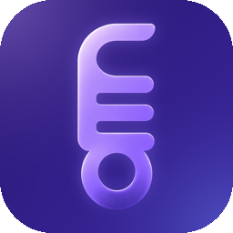
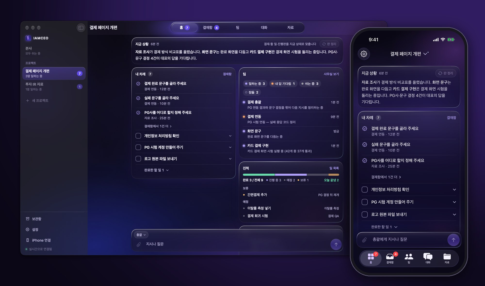
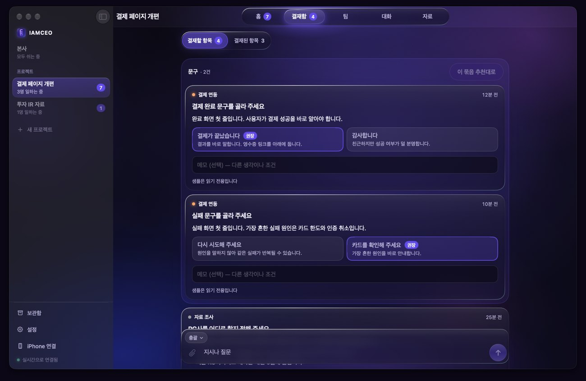
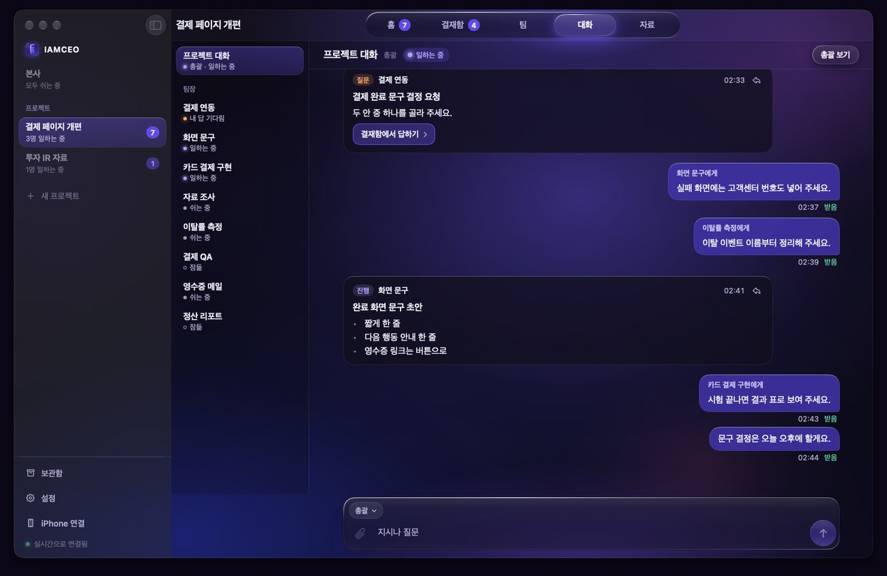
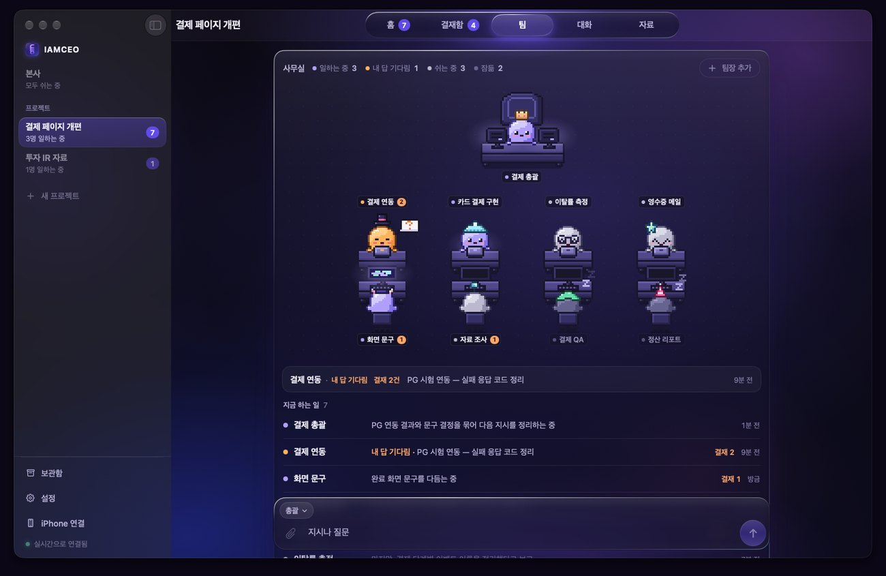
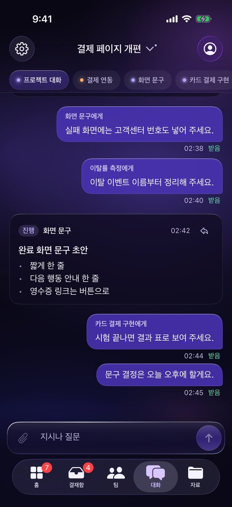
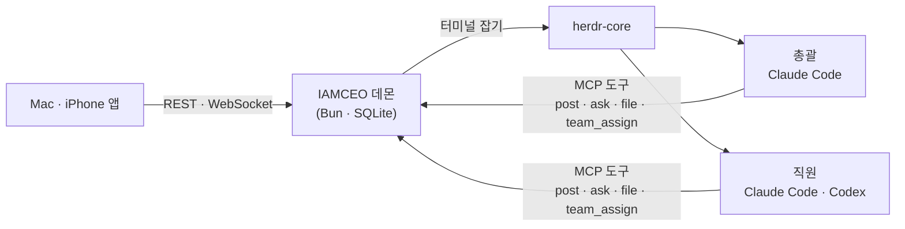

<div align="center">



# IAMCEO

**AI 코딩 에이전트를 회사처럼 부리세요. 당신은 말하고, 결정만 합니다.**

Claude Code·Codex 세션 여럿을 총괄과 직원으로 나눠 일을 맡기고,<br/>
Mac과 iPhone 한 화면에서 지시하고 결재합니다.

[](https://github.com/yehsung/IAMCEO/releases/latest)
[](#설치)
[](LICENSE)

[설치](#설치) · [빠른 시작](#빠른-시작) · [화면](#화면) · [어떻게 돌아가나](#어떻게-돌아가나) · [운영 원칙](docs/operating-model.md) · [English](README.md)



</div>

- **터미널을 지켜보지 않아도 됩니다** — 누가 일하고, 누가 끝났고, 누가 승인 창 앞에 멈췄는지 홈 한 화면에 보입니다.
- **결정은 결재함 하나로** — 직원의 질문과 승인 요청이 배경·선택지별 결과·추천과 함께 카드로 옵니다.
- **일 하나에 직원 하나** — 총괄이 일을 나눠 맞는 직원에게 맡깁니다. 일마다 세션이 따로라 맥락이 섞이지 않습니다.
- **결과물은 자료에** — 문서·표·이미지·영상·HTML 페이지를 경로가 아니라 앱 안에서 바로 엽니다.
- **자리를 떠도 계속** — iPhone으로 지시하고 결재하고 알림을 받습니다. Mac이 깨어 있는 동안 일은 멈추지 않습니다.
- **기록은 내 Mac에** — 대화·결재·자료는 내 Mac의 SQLite에 남습니다. AI 계정을 바꿔도 그대로입니다.

Mac·iPhone 네이티브 앱을 사용합니다. 웹 버전은 2026-11-10 제거했으며 기존 앱의 API 계약은 유지합니다.

## 설치

```sh
brew install --cask yehsung/tap/iamceo
```

또는 `curl -fsSL https://raw.githubusercontent.com/yehsung/IAMCEO/main/install.sh | sh` · [릴리스에서 DMG 받기](https://github.com/yehsung/IAMCEO/releases/latest)

**필요한 것:** Apple Silicon Mac(macOS 14 이상), 설치하고 로그인한 [Claude Code](https://claude.com/claude-code). [Codex CLI](https://github.com/openai/codex)는 선택입니다. AI는 각자의 계정과 사용 한도로 돕니다.

## 빠른 시작

1. IAMCEO를 열고 **이 Mac에서 시작**을 누릅니다. 서버가 로그인 항목으로 등록되고 바로 연결됩니다.
2. **새 프로젝트**에서 작업 폴더를 고릅니다(새 폴더, GitHub에서 가져오기도 됩니다). 프로젝트마다 총괄이 생깁니다.
3. **대화**에 원하는 일을 적습니다. 총괄이 맞는 직원을 정해 일을 넘깁니다.
   > 나: 결제 실패 화면 문구에 고객센터 번호를 넣어 줘<br/>
   > 총괄: 접수했습니다 — 화면 문구 직원에게 맡겼습니다.
4. 결정할 일은 **결재함**, 결과물은 **자료**, 내가 직접 할 일은 **홈**에 모입니다.

**iPhone:** Mac과 iPhone을 [Tailscale](https://tailscale.com)에 연결한 뒤 Mac 앱의 **iPhone 연결** QR을 찍습니다. iPhone 앱은 지금은 소스에서 직접 빌드합니다 → [안내](native/README.md)

## 화면

<table>
<tr>
<td width="50%"><br/><b>결재함</b> — 결정이 필요한 카드와 지난 결재</td>
<td width="50%"><br/><b>대화</b> — 총괄·직원과의 지시와 보고, 전달 상태</td>
</tr>
<tr>
<td width="50%"><br/><b>팀</b> — 직원마다 책상 하나, 일하는 중·대기·승인 대기·잠듦</td>
<td width="50%" align="center"><br/><b>iPhone</b> — 자리를 떠도 같은 화면</td>
</tr>
</table>

## 어떻게 돌아가나



- **공식 CLI를 그대로 씁니다.** Claude Code와 Codex가 내 계정 로그인으로 대화형 터미널에서 돕니다. IAMCEO는 역할 지침과 MCP 연결만 더합니다.
- **세션은 앱과 서버보다 오래 삽니다.** [herdr-core](https://github.com/herdrdev/herdr-core)가 터미널을 붙잡고 있어서, 앱을 닫거나 서버를 다시 켜도 일은 이어집니다.
- **보고는 화면 긁기가 아니라 도구 호출입니다.** 보고(`post`), 결재 요청(`ask`), 자료(`file`), 일 맡기기(`team_assign`)가 모두 기록으로 남습니다.
- **대표만 결정합니다.** 외부로 보내기, 커밋·푸시, 삭제, 결제는 대표가 쓴 문장이 있어야 합니다. 총괄이 대표 말을 인용하면 서버가 원문과 대조해 표시합니다.

구성 요소는 [구조](docs/architecture.md), 모든 규칙은 [운영 원칙](docs/operating-model.md)에 있습니다.

<details>
<summary><b>소스에서 빌드하기</b></summary>

필요한 것: Xcode 26, [XcodeGen](https://github.com/yonaskolb/XcodeGen), [Bun](https://bun.sh) 1.3 이상.

```sh
git clone https://github.com/yehsung/IAMCEO.git && cd IAMCEO
bun install
bun run build:native            # dist/native/IAMCEO.app
open -n dist/native/IAMCEO.app --args --demo   # 연결 없는 샘플 화면
```

시험은 임시 데이터 홈·자동 포트·가짜 CLI로 격리해 돕니다.

```sh
bun run check   # 타입 검사 · 서버 시험 · 앱 시험 · 서명 없는 빌드
```

iPhone에 직접 설치하려면 `native/project.yml`의 번들 ID와 팀을 자기 것으로 바꿉니다 → [네이티브 안내](native/README.md)

</details>

## 감사

터미널을 붙잡아 두는 일은 [herdr-core](https://github.com/herdrdev/herdr-core)(Apache-2.0)가 합니다. 함께 쓰는 오픈소스의 고지는 [THIRD-PARTY-NOTICES.md](THIRD-PARTY-NOTICES.md)에 있습니다.

## 라이선스

IAMCEO는 **소스 공개형**입니다(Sustainable Use License 1.0 + IAMCEO 추가 허락).

- 개인·회사 안에서 쓰기, 고치기, 무료로 나누기, 고객 일을 하는 도구로 쓰기는 자유입니다.
- IAMCEO나 고친 판을 팔기, 유료 호스팅·SaaS로 제공하기, 상용 제품에 넣기는 별도 허락이 필요합니다.

자세한 설명은 [LICENSING.ko.md](docs/LICENSING.ko.md), 기여 방법은 [CONTRIBUTING.md](CONTRIBUTING.md)를 보세요. 2026년 11월 7일 전에 공개한 판(v0.1.0 포함)은 AGPL-3.0-only로 배포됐고, 받은 사람은 그 권리를 그대로 가집니다.
