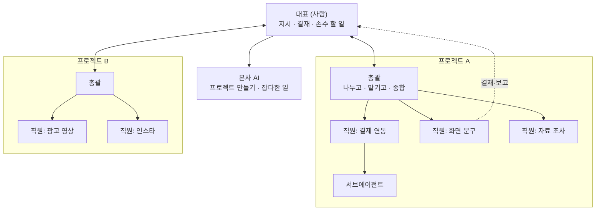
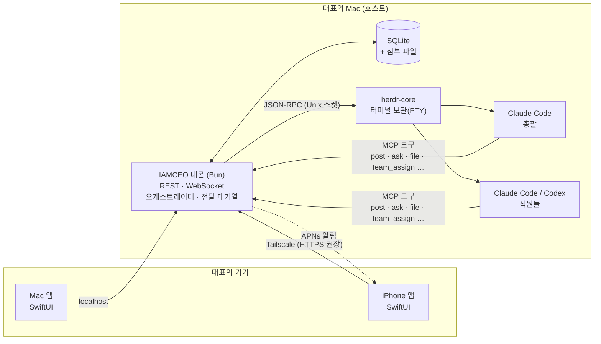
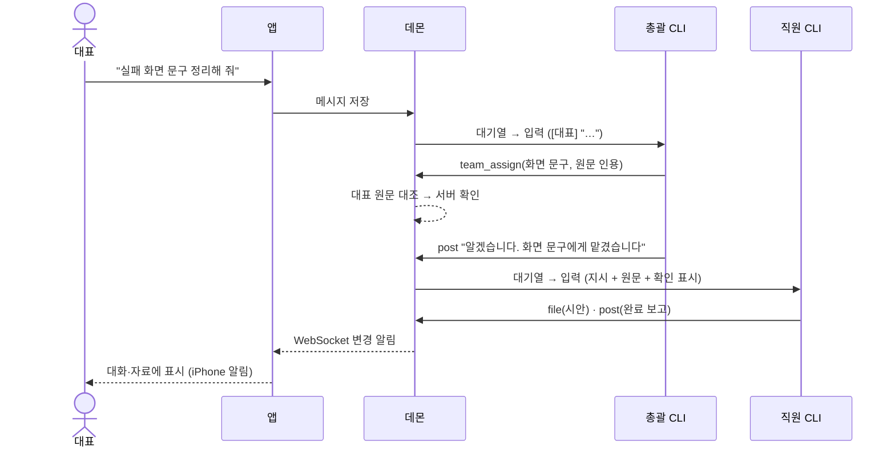

# IAMCEO

[English](README.md)

**당신은 대표, AI는 직원입니다.** IAMCEO는 Claude Code·Codex 세션 여럿을 하나의 회사처럼 부리는 Mac·iPhone 업무 창구입니다. 대표는 말하고 결정만 합니다. 일을 나누는 것은 총괄, 실제 일은 직원, 전달과 기록은 서버가 맡습니다.

터미널 창을 오가며 세션을 지켜볼 필요가 없습니다. 홈·결재함·팀·대화·자료 다섯 화면에서 지시하고, 결재하고, 결과를 받습니다.

## 왜 만들었나

AI 코딩 에이전트를 혼자 여럿 돌려 보면 같은 문제가 반복됩니다.

- **계속 지켜봐야 합니다.** 어느 세션이 일하는지, 끝났는지, 승인 창 앞에 멈췄는지 알려면 터미널을 하나하나 열어 봐야 합니다.
- **질문과 승인을 놓칩니다.** 세션마다 따로 묻다 보니 대답할 것이 여러 창에 흩어지고, 대답을 기다리느라 일이 멈춥니다.
- **문맥이 섞입니다.** 한 세션에 성격이 다른 일을 계속 넣으면 앞 일의 문맥이 다음 일을 흐립니다.
- **결과물이 내 손에 안 옵니다.** "~/project/out/report.md 에 저장했습니다"라는 경로만 남고, 폰에서는 열어 볼 수 없습니다.
- **자리를 비우면 멈춥니다.** 밖에서는 지시도, 결재도, 진행 확인도 할 수 없습니다.

IAMCEO는 이 문제를 **회사 구조**로 풉니다. 사람 한 명(대표)과 AI 세션 여럿이 역할을 나누고, 역할마다 해도 되는 일과 하면 안 되는 일을 정했습니다. 일부 규칙은 서버가 강제하고, 일부는 세션마다 주는 역할 규칙으로 지키게 합니다.

## 회사 구조



| 역할 | 수 | 하는 일 | 하지 않는 일 |
|---|---|---|---|
| **대표** (사람) | 1 | 지시, 결재, 대표가 손수 해야 하는 일(로그인·결제 등) | |
| **본사 AI** | 전체 1 | 새 프로젝트 만들기, 어느 프로젝트에도 속하지 않는 일 | 이미 있는 프로젝트의 일 떠안기 |
| **총괄** | 프로젝트당 1 | 일 나누기, 맞는 직원에게 맡기기, 보고 종합, 판 정리 | 코드 수정·조사를 직접 하기, 대표 대신 답하기 |
| **직원** | 프로젝트당 여럿 | 실제 일(코드·문서·조사·배포 준비) | 대표 승인 없이 되돌리기 어려운 일 |
| **서브에이전트** | 직원 아래 | 직원이 나눈 조각 일(병렬) | 대표에게 직접 보고 |

직원은 **맡은 일 하나**를 위해 둡니다. 이름도 사람 이름이 아니라 맡은 일로 짓습니다(`결제 연동`, `화면 문구`). 총괄과 직원은 각자 Claude Code 또는 Codex를 쓸 수 있습니다.

## 철칙

1. **결정은 대표만 한다.** AI는 대표 대신 답하지 않습니다. 총괄의 "진행해"는 승인이 아닙니다. 외부 제출·발송, 착수, 커밋·푸시, 삭제, 비용이 드는 일은 그 일을 하라는 대표의 문장이 있을 때만 합니다.
   - *서버가 대조:* 총괄이 지시에 대표의 말을 인용하면, 서버가 대표 메시지·결재 답 원문과 맞춰 보고 `서버 확인`·`문맥 확인 필요`(버튼 글·아주 짧은 글)·`미확인`을 붙입니다. 이 표시와 원문을 보고 승인인지 판단해 멈추는 것은 직원의 역할 규칙입니다.
   - *서버가 직접 전달:* 결재 답은 서버가 물은 직원에게 원문 그대로 보내므로, 총괄이 중간에서 바꿀 수 없습니다.
2. **총괄은 일하지 않는다.** 나누고, 맡기고, 종합합니다. 실제 일은 직원이 합니다.
3. **한 직원에 한 역할.** 문맥을 섞지 않으려고 직원을 나눕니다.
   - 맞는 직원이 잠들어 있으면 새로 뽑지 않고 깨워서 기록을 이어 갑니다.
   - 맞는 직원이 없을 때만 새로 뽑습니다.
   - 일하는 중인 직원에게는 끼어들지 않고 대기열에 넣습니다.
4. **대표는 터미널을 보지 않는다.**
   - 일을 맡기면 총괄이 바로 "알겠습니다, ○○에게 맡겼습니다"라고 답합니다.
   - 끝나거나 막히면 대화에 보고가 올라옵니다.
   - 결과물(문서·표·이미지·영상)은 경로만 남기지 않고 자료에 올립니다.
   - *서버가 보완:* 대표의 말로 시작한 턴에서 총괄이 일을 맡기고 아무 `post` 없이 턴을 마치면, 서버가 "총괄이 ○○에게 맡겼습니다"를 대화에 남깁니다.
5. **판단할 것은 결재함 한 곳으로.** 질문·선택·승인은 모두 결재함 카드로 모입니다.
   - 카드만 읽고 고를 수 있게 배경, 선택지별 결과, 추천을 적습니다.
   - 대표가 손수 해야 하는 일은 '내 할 일'로 따로 받습니다.
6. **전달은 서버가 책임진다.** 대기열, 잠든 직원 깨우기, 끝난 뒤 다음 일 넣기, 받은 글에 출처 붙이기를 서버가 합니다. 전달이 됐는지 불확실하면 **자동으로 다시 보내지 않습니다**. 같은 지시가 두 번 들어가는 것보다 멈춰서 확인하는 쪽을 택합니다. 대표가 확인하고 중복 위험에 동의하면 다시 보낼 수 있습니다.
7. **기록은 대표의 것이다.** 대화·결재·업무·자료 기록은 대표의 Mac에 있는 SQLite에, 첨부 파일 본체는 그 옆 폴더에 남습니다. AI 계정이 바뀌어도 사라지지 않고, 함께 정기 백업됩니다.

## 쓰는 법

**1. 프로젝트를 만든다.** 작업 폴더를 고르거나, 새 폴더를 만들거나, GitHub 저장소를 가져옵니다. 프로젝트마다 총괄이 생깁니다.

**2. 대화에서 총괄에게 말한다.**

> 대표: 결제 실패 화면 문구를 고객센터 번호가 들어가게 정리해 줘
>
> 총괄: 알겠습니다. 화면 문구에게 맡겼습니다.

특정 직원에게 바로 말할 수도 있습니다. 대화 화면에서 그 직원을 고르면 됩니다.

**3. 직원이 일하고 보고한다.** 진행·완료·막힘 보고가 대화에 올라오고, 산출물은 자료에 쌓입니다. 대화 속 파일 경로를 누르면 앱에서 바로 미리 보고 자료로 올릴 수 있습니다.

**4. 결재한다.** 대표의 판단이 필요하면 결재함에 카드가 생깁니다. iPhone 알림을 켜 두면 알림도 옵니다. 선택지를 고르고 확인을 누르면 물은 직원에게 바로 전달됩니다. Claude·Codex의 폴더 신뢰 창 앞에 멈춘 직원도 결재함에서 고르고 확인합니다. 그 밖의 CLI 권한 창이나 알아보지 못한 창은 터미널에서 직접 조작합니다.

**5. 필요할 때만 들여다본다.**

| 화면 | 보는 것 |
|---|---|
| **홈** | 지금 상황 한 단락, 내 차례(답할 결재·승인 대기·막힌 전달), 팀·진척·최근 소식 |
| **결재함** | 대표가 정해야 할 카드, 지난 결재 기록 |
| **팀** | 사무실 그림(책상마다 일하는 중·대기·승인 대기·잠듦), 직원 상세, 진행판, 터미널 |
| **대화** | 총괄·직원과 주고받은 말과 보고, 전달 상태(전달 대기·받음) |
| **자료** | 문서·표·코드·이미지·영상·HTML 페이지(아티팩트) |

터미널은 꼭 필요할 때만 엽니다. 직접 조작하는 동안은 자동 전달이 멈춰서 입력이 서로 섞이지 않습니다. 조작권은 마지막 입력 뒤 5분이 지나면 풀립니다.

## 시스템 구조



- **상태의 원본은 데몬과 SQLite입니다.** 앱은 상태를 읽고 요청을 보낼 뿐, 따로 판단하지 않습니다. Mac과 iPhone이 같은 상태를 봅니다.
- **AI는 공식 CLI 그대로 씁니다.** Claude Code와 Codex를 사용자 계정 로그인 그대로, 대화형 터미널에서 실행합니다. IAMCEO는 실행마다 역할 규칙과 MCP 연결만 더합니다. 모델 API를 따로 구현하지 않습니다.
- **세션은 앱·서버보다 오래 삽니다.** 터미널은 herdr-core가 보관합니다. 앱을 닫거나 서버를 다시 시작해도 CLI는 계속 일하고, 서버가 다시 뜨면 같은 터미널에 다시 붙습니다.
- **보고는 화면 긁기가 아니라 도구 호출입니다.** 세션은 `post`(보고), `ask`(결재), `todo`(대표 할 일), `file`(자료), `team_assign`(맡기기) 같은 MCP 도구로 서버에 남깁니다.
- **상태는 추측하지 않습니다.** 일하는 중·대기·승인 대기는 CLI가 내보내는 상태 표식(OSC 7501)과 턴 번호로 판단합니다. 모르면 자동 입력을 멈춥니다.

지시 하나가 흘러가는 길:



더 자세한 구성은 [전체 구조](docs/architecture.md), 규칙 전체는 [운영 모델](docs/operating-model.md)에 있습니다.

## 시작하기

### Mac

macOS 14 이상, Swift 6을 제공하는 Xcode, XcodeGen, Bun 1.3 이상이 필요합니다. 쓸 공식 CLI(Claude Code, Codex)는 미리 설치하고 로그인해 둡니다. Liquid Glass 효과는 macOS·iOS 26 이상에서 쓰고, 이전 OS에서는 반투명 재질로 표시합니다.

```sh
bun install
bun run build:native
open dist/native/IAMCEO.app
```

앱을 안정적인 위치(예: `/Applications`)에 둔 뒤 **이 Mac에서 시작**을 누릅니다.
- 앱이 내장한 데몬을 launchd 서비스로 등록합니다. 빌드만으로는 서비스를 설치하거나 실행하지 않습니다.
- 이미 정상 동작하는 IAMCEO가 있으면 거기에 연결하고, 다른 설치와 충돌하면 덮어쓰지 않습니다.
- herdr-core는 고정 버전·체크섬·서명을 확인해 앱 안에 들어 있어서 따로 설치할 필요가 없습니다.
- 데이터는 `~/.iamceo`에 둡니다.

```sh
# 연결 없이 화면만 보는 읽기 전용 샘플
open -n dist/native/IAMCEO.app --args --demo

# 앱 없이 소스에서 서버 실행
bun run setup:core
bun run start
bun bin/iamceo.ts open   # 별도 터미널: 주소와 접속 코드
```

### iPhone

1. `xcodegen generate --spec native/project.yml`로 프로젝트를 만들고 `IAMCEO-iOS` 스킴으로 설치합니다. 실기기에는 Apple 개발 팀 서명이 필요합니다. 자세한 명령은 [네이티브 안내](native/README.md)에 있습니다.
2. Mac과 iPhone에 Tailscale을 켭니다. **Tailscale Serve HTTPS**로 Mac의 `http://127.0.0.1:7878`을 내보내고, iPhone 앱에 그 HTTPS 주소와 접속 코드를 넣는 연결을 권장합니다. 접속 코드는 `bun bin/iamceo.ts open`으로 봅니다.
3. 더 간단히는 Mac 앱의 **iPhone 연결**에서 나온 QR을 iPhone으로 비춥니다. 이 QR은 데몬의 Tailscale 주소(HTTP, MagicDNS 이름)를 담습니다. 접속 코드는 기기 Keychain에 보관합니다.

앱을 닫아도 일은 Mac에서 이어집니다. 단, Mac이 깨어 있어야 하며 잠자기·전원 꺼짐·재부팅 중의 실행은 보장하지 않습니다. 호스트에 APNs 키를 설정하고 iPhone 앱 설정에서 알림을 켜면(OS 권한 허용), 새 결재·승인 대기·오류·완료 보고 알림을 받습니다. 앱을 보고 있을 때는 배너 없이 화면만 갱신합니다.

## 현재 범위

- 실행 권한 기본값은 `bypassPermissions`이며 설정에서 바꿀 수 있습니다. 각 CLI는 호스트 사용자 권한으로 실행되며, 사용 한도는 각 제공자의 정책을 따릅니다.
- 제공자(Claude↔Codex) 교체는 **새 세션 + 업무 인계**입니다. 업무·대화·결재 기록은 남지만 모델 내부 문맥까지 옮기지는 않습니다.
- 자료의 HTML 페이지는 스크립트와 외부 요청을 끈 미리보기로 보여 줍니다.
- 웹 화면(`web/`)은 임시로 남겨 둔 레거시이며 **곧 없앱니다.** 그때까지 같은 서버 API로 호환만 유지하고, 새 기능은 넣지 않습니다.
- Windows·Android, 공증된 배포본, Intel Mac 실기기 검증은 아직 범위 밖입니다.

## 개발

```sh
bash .pumasi/gates.sh ts      # 타입 검사
bash .pumasi/regress.sh       # 서버 회귀 시험(임시 홈·가짜 CLI)
bash .pumasi/gates.sh swift   # 앱 빌드·시험
bash .pumasi/gates.sh xcode   # 서명 없는 macOS·iOS 시뮬레이터 빌드
```

시험은 임시 데이터 홈, 자동 배정 포트, 가짜 CLI를 씁니다. 실제 데이터 홈이나 7878 포트, 실행 중인 서비스로 시험하지 않습니다. 자세한 격리 규칙은 [운영 모델](docs/operating-model.md#격리-시험-실행)에 있습니다.

[전체 구조](docs/architecture.md) · [운영 모델](docs/operating-model.md) · [구현 계약](docs/spec.md) · [빌드·연결 상세](native/README.md) · [herdr-core 출처](vendor/herdr-core/README.md)

## 라이선스

IAMCEO는 오픈소스가 아니라 **소스 공개형(source-available)** 소프트웨어입니다. [IAMCEO 라이선스](LICENSE)는 Sustainable Use License 1.0에 IAMCEO 추가 허락을 더한 것입니다.

- **허용:** 코드를 보고 배우고, 쓰고, 고치고, 무료로 비상업적으로 나눌 수 있습니다. 회사 안에서 업무에 써도 됩니다.
- **도구로 쓰는 일도 허용:** 고객 일을 처리하는 도구로 쓰고, 그 결과물을 팔고, 설치·지원 대행 요금을 받을 수 있습니다.
- **별도 허락 필요:** IAMCEO나 고친 판을 판매하는 것, 유료 호스팅·SaaS로 제공하는 것, 상업 제품에 넣어 배포하는 것입니다.

쉬운 설명은 [docs/LICENSING.ko.md](docs/LICENSING.ko.md)에, 기여 안내는 [CONTRIBUTING.md](CONTRIBUTING.md)에 있습니다.

2026년 11월 7일 이전에 공개된 버전(v0.1.0 포함)은 AGPL-3.0-only로 배포됐고, 받은 사람에게는 그대로 남습니다. 포함된 외부 구성요소는 각자의 라이선스를 따릅니다. herdr-core는 Apache-2.0이며, 그 라이선스·고지·공식 서명을 보존합니다. 자세한 목록은 [THIRD-PARTY-NOTICES.md](THIRD-PARTY-NOTICES.md)에 있습니다.
