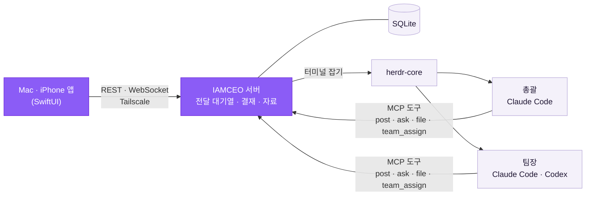

<div align="center">


# IAMCEO

**AI 코딩 에이전트를 회사처럼 부리세요. 당신은 말하고, 결정만 합니다.**

Claude Code·Codex 세션 여럿을 총괄과 팀장으로 나눠 일을 맡기고,<br/>
Mac과 iPhone 한 화면에서 지시하고 결재합니다.

[](https://github.com/yehsung/IAMCEO/releases/latest)
[](#설치)
[](LICENSE)

[설치](#설치) · [빠른 시작](#빠른-시작) · [사용자 문서](docs/guide/README.md) · [용어](#용어) · [무엇이 다른가](#무엇이-다른가) · [어떻게 돌아가나](#어떻게-돌아가나) · [보안](docs/security.md) · [변경 기록](CHANGELOG.md) · [English](README.md)


</div>

- **터미널을 지켜보지 않아도 됩니다** — 누가 일하고, 누가 끝났고, 누가 승인 창 앞에 멈췄는지 홈 한 화면에 보입니다.
- **결정은 결재함 하나로** — 팀장의 질문과 승인 요청이 배경·선택지별 결과·추천과 함께 카드로 옵니다.
- **일 하나에 팀장 하나** — 총괄이 일을 나눠 맞는 팀장에게 맡깁니다. 일마다 세션이 따로라 맥락이 섞이지 않습니다.
- **결과물은 자료에** — 문서·표·이미지·영상·HTML 페이지를 경로가 아니라 앱 안에서 바로 엽니다.
- **자리를 떠도 계속** — iPhone으로 지시하고 결재합니다. Mac이 깨어 있는 동안 일은 멈추지 않습니다. iPhone 알림에는 조건이 있습니다 → [알림](#알림)
- **기록은 내 Mac에** — 대화·결재·자료는 내 Mac의 SQLite에 남습니다. AI 계정을 바꿔도 그대로입니다.
- **해 둔 설정을 그대로 이어 씁니다** — 공식 Claude Code·Codex CLI가 내 로그인으로 그대로 돕니다. 설정 파일에 적어 둔 설정, MCP 서버, 스킬, `CLAUDE.md`는 그대로 적용됩니다. → [무엇이 다른가](#무엇이-다른가)
- **바퀴를 다시 만들지 않았습니다** — 공식 CLI·herdr-core·MCP·SQLite·Tailscale은 그대로 쓰고, 그 위에서 '회사처럼 일하게 하는' 부분만 만들었습니다. → [설계](#어떻게-돌아가나)

Mac·iPhone 네이티브 앱을 사용합니다. iOS 앱은 iPhone 전용이며 iPad는 지원하지 않습니다. 웹 버전은 2026-11-10 제거했으며 기존 앱의 API 계약은 유지합니다.

## 설치

```sh
brew install --cask yehsung/tap/iamceo
```

또는 `curl -fsSL https://raw.githubusercontent.com/yehsung/IAMCEO/main/install.sh | sh` · [릴리스에서 DMG 받기](https://github.com/yehsung/IAMCEO/releases/latest)

**필요한 것:** Apple Silicon Mac(macOS 14 이상), 설치하고 로그인한 [Claude Code](https://claude.com/claude-code). [Codex CLI](https://github.com/openai/codex)는 선택입니다. AI는 각자의 계정과 사용 한도로 돕니다.

**시작하기 전에 알아 둘 것:** 총괄과 팀장은 기본으로 승인 창에서 멈추지 않고 명령을 실행합니다(Claude Code는 `bypassPermissions` 방식, Codex는 승인과 샌드박스를 건너뛰는 방식). 이 Mac에서 처음 시작할 때 세 가지 중 하나를 고릅니다. 묻지 않기(기본 선택), 위험할 때만 묻기, 매번 묻기입니다. 나중에 설정에서 바꿀 수 있습니다. 서버가 강제하는 것과 약속일 뿐인 것은 [누가 결정하나](#누가-결정하나)에, 무엇을 믿고 무엇을 막는지는 [보안 설명서](docs/security.md)에 있습니다.

## 빠른 시작

1. IAMCEO를 열고 **이 Mac에서 시작**을 누릅니다. 서버가 로그인 항목으로 등록되고 바로 연결됩니다.
2. **새 프로젝트**에서 작업 폴더를 고릅니다(새 폴더, GitHub에서 가져오기도 됩니다). 프로젝트마다 총괄이 생깁니다.
3. **대화**에 원하는 일을 적습니다. 총괄이 맞는 팀장을 정해 일을 넘깁니다.
   > 나: 결제 실패 화면 문구에 고객센터 번호를 넣어 줘<br/>
   > 총괄: 접수했습니다 — 화면 문구 팀장에게 맡겼습니다.
4. 결정할 일은 **결재함**, 결과물은 **자료**, 내가 직접 할 일은 **홈**에 모입니다.

**iPhone:** Mac과 iPhone을 [Tailscale](https://tailscale.com)에 연결한 뒤 Mac 앱의 **iPhone 연결** QR을 찍습니다. iPhone 앱은 [App Store에서 받습니다](https://apps.apple.com/app/id6831782194). 쓰던 iPhone이 연결되지 않으면 Mac의 Tailscale이 켜져 있는지 확인해 주세요. 꺼져 있으면 Mac 앱이 알려 줍니다. → [iPhone 연결](docs/guide/iphone.md)

**막히면(0.2.4부터):** 설정 → AI 모델 → 실행 환경이 실행 엔진, Claude Code·Codex 로그인, Tailscale, 자동 시작, 백업을 항목마다 점검하고 고치는 법을 알려 줍니다. 명령줄의 `iamceo doctor`도 같은 점검을 합니다. → [문제 해결](docs/guide/troubleshooting.md)

### 알림

- **Mac:** 됩니다. Mac 앱의 설정에서 **Mac 알림**을 켭니다.
- **iPhone:** 알림은 내 Mac의 서버에 그 iPhone 앱의 Apple 알림 키가 있을 때만 갑니다. IAMCEO가 운영하는 서버가 없어서 대신 보내 줄 곳이 없습니다. 그래서 App Store에서 받은 iPhone 앱은 **지금 알림을 받을 수 없습니다.** 직접 빌드한 iPhone 앱과 자신의 키가 있을 때만 됩니다 → [네이티브 안내](native/README.md#iphone-apns-and-signing)

### 사용자 문서

| 문서 | 무엇을 |
|---|---|
| [시작하기](docs/guide/getting-started.md) | 준비물 점검표, 설치, 첫 프로젝트, 보고 언어, 명령줄 도구 |
| [문제 해결](docs/guide/troubleshooting.md) | 실행 환경 점검, 자주 막히는 곳, 진단 파일, 역할 지침 고치기 |
| [iPhone 연결](docs/guide/iphone.md) | Tailscale·MagicDNS, 연결 QR, 알림의 조건 |
| [업그레이드·백업·제거](docs/guide/upgrade-backup-uninstall.md) | 새 버전과 되돌리기, 백업과 새 Mac, 보존 기한, 프로젝트 내보내기·삭제, 완전히 멈추기 |
| [보안 설명서](docs/security.md) | 무엇을 믿고, 막고, 막지 못하는지 |

### 제거

앱만 휴지통에 버리면 이미 떠 있는 서버와 AI 세션이 남을 수 있습니다. 먼저 IAMCEO를 완전히 멈춘 뒤 앱을 지웁니다. 아래 1번의 버튼과 `uninstall`은 0.2.4부터 있습니다. 0.2.3 이하에서는 터미널에서 `/Applications/IAMCEO.app/Contents/Resources/runtime/iamceo service uninstall`로 로그인 서비스를 해제한 뒤 Mac을 다시 시작합니다(실행 엔진과 AI 세션이 함께 끝납니다).

1. Mac 앱의 **설정 → 연결** 맨 아래 **이 Mac에서 완전히 멈추기**를 누르거나, 터미널에서 `/Applications/IAMCEO.app/Contents/Resources/runtime/iamceo uninstall`을 실행합니다. 팀장을 모두 재우고, 로그인 서비스를 해제하고, 실행 엔진을 끕니다. 데이터(`~/.iamceo`)는 남습니다. 데이터까지 지우려면 `uninstall --purge`를 씁니다(그 안의 백업도 함께 지워지고, 되돌릴 수 없습니다).
2. 앱을 지웁니다. Homebrew로 설치했다면 `brew uninstall --cask iamceo`, 아니면 응용 프로그램 폴더의 IAMCEO를 휴지통으로 옮깁니다. `brew uninstall --zap --cask iamceo`는 1번의 멈추기와 데이터 삭제까지 한 번에 합니다.

자세한 순서는 [업그레이드·백업·제거](docs/guide/upgrade-backup-uninstall.md#이-mac에서-완전히-멈추기제거)에 있습니다.

## 용어

| 이름 | 무엇인가 |
|---|---|
| 총괄 | 프로젝트마다 하나. 일을 나눠 팀장에게 맡기고 보고를 종합합니다. 직접 일하지 않습니다. |
| 팀장 | 실제로 일하는 세션. 프로젝트에 여럿이고, 일의 종류마다 하나씩 둡니다. |
| 직원 | 팀장이 자기 CLI 안에서 부리는 서브에이전트. 맡은 일의 한 조각을 하고 팀장에게만 보고합니다. 대표에게 직접 보고하지 않습니다. |
| 본사 | 어느 프로젝트에도 속하지 않는 칸. 아래 설명을 보세요. |
| 결재함 | 질문과 승인 요청이 대표의 답을 기다리는 곳. |

**본사**는 자동으로 만들어지고 보관할 수 없습니다. 본사 AI 하나가 새 프로젝트를 만들어 주고, 어느 프로젝트에도 속하지 않는 한 번짜리 일을 처리합니다.
본사에는 팀장이 없고, 작업 폴더는 내 홈 폴더입니다.

## 화면

<table>
<tr>
<td width="50%"><br/><b>결재함</b> — 결정이 필요한 카드와 지난 결재</td>
<td width="50%"><br/><b>대화</b> — 총괄·팀장과의 지시와 보고, 전달 상태</td>
</tr>
<tr>
<td width="50%"><br/><b>팀</b> — 팀장마다 책상 하나, 일하는 중·대기·승인 대기·잠듦</td>
<td width="50%" align="center"><br/><b>iPhone</b> — 자리를 떠도 같은 화면</td>
</tr>
</table>

## 무엇이 다른가

코드가 실제로 하는 것만 적습니다.

- **결정이 대화에 묻히지 않습니다.** 질문과 승인 요청은 모두 결재함의 카드가 됩니다. 총괄이 대표의 말을 팀장에게 옮기면, 서버가 그 인용을 대표가 실제로 쓴 글과 대조해, 확인한 원문인지 확인하지 못한 인용인지 표시합니다.
- **전달을 짐작하지 않고 확인합니다.** 대표의 말을 CLI에 넣은 뒤, CLI가 스스로 남기는 세션 기록에서 그 말을 찾습니다. 알 수 없으면 같은 말을 다시 넣지 않습니다.
- **기록이 내게 남습니다.** 대화·결재·자료는 내 Mac의 SQLite에 남고, iPhone 네이티브 앱에서 읽고 답합니다.
- **해 둔 설정을 그대로 이어 씁니다.** IAMCEO는 공식 `claude`·`codex` 프로그램을 내 프로젝트 폴더에서, 내 사용자 계정과 평소의 설정 폴더 그대로 실행합니다. 내 설정을 끄거나 갈아 끼우는 옵션을 넘기지 않고, CLI의 설정 파일에 쓰지도 않습니다. 그래서 CLI가 설정 파일과 폴더에서 읽는 것은 여기서도 그대로 읽힙니다.
  - 로그인과 구독
  - 사용자 설정과 프로젝트 설정(`~/.claude/settings.json`, 프로젝트의 `.claude/` 폴더, `~/.codex/config.toml`). 훅도 포함입니다.
  - 이미 연결해 둔 MCP 서버. IAMCEO는 세션에 자기 것 하나를 더할 뿐 내 것은 그대로 둡니다.
  - 스킬, 플러그인, 직접 만든 명령
  - `CLAUDE.md`와 `AGENTS.md`. IAMCEO의 역할 지침은 이 파일들과 나란히 넘어갈 뿐 대신하지 않습니다.

  넘어가지 않는 것이 하나 있습니다. 터미널의 셸 환경입니다. 서버는 로그인 항목으로 떠서, 셸 설정 파일(`~/.zshrc` 등)에서 정한 환경 변수와 PATH를 받지 않습니다. CLI는 그 서버의 환경으로 실행됩니다. 그래서 환경 변수에 기대는 것(`${GITHUB_TOKEN}`처럼 변수를 참조하는 MCP 서버, `ANTHROPIC_API_KEY`로 하는 로그인)과 특정 PATH에 기대는 것(pyenv·mise·cargo로 설치한 `uvx`·`node`를 부르는 MCP 서버나 훅)은 터미널에서는 되어도 여기서는 실패할 수 있습니다. 그런 값은 CLI 설정 파일의 `env`에 적고, 명령은 절대 경로로 적어 주세요.

  IAMCEO가 자기 세션을 켤 때마다 따로 정하는 것은 다음뿐입니다.
  - IAMCEO에서 고른 권한 방식. IAMCEO 자신의 도구는 묻지 않고 쓰게 허용합니다.
  - 모델과 effort. IAMCEO에서 골랐을 때만 넘기고, 고르지 않았으면 CLI 기본값을 씁니다.
  - Claude Code: 문맥 사용량을 읽으려고 상태줄을 한 겹 감쌉니다(내 상태줄 명령은 그대로 실행됩니다). 입력칸의 추천 문구는 끕니다.
  - Codex: 여러 에이전트 기능을 켜고, 시작할 때의 업데이트 확인을 끕니다. 역할 지침은 `developer_instructions`로 넘기므로, 이 세션에서는 `config.toml`에 적어 둔 같은 항목을 대신합니다.

**하지 않는 것**

- **팀장마다 작업 폴더를 나누지 않습니다.** 한 프로젝트의 팀장들은 프로젝트 폴더를 함께 씁니다. 세션마다 git worktree를 만들지 않습니다. 같은 파일을 건드릴 일은 같은 팀장에게 보내 줄을 세우라고 총괄에게 지시할 뿐, 팀장 사이에 파일을 잠그는 장치는 없습니다.
- **자동으로 병합하지 않습니다.** 브랜치를 만들거나 합쳐 주지 않습니다.
- **자체 샌드박스가 없습니다.** 에이전트는 내 macOS 사용자로, 내가 고른 권한 방식으로 돕니다 → [보안 설명서](docs/security.md)

## 어떻게 돌아가나

**이미 잘 만들어진 것은 그대로 쓰고, 없던 부분만 직접 만들었습니다.** AI 모델도, 터미널도, AI와 주고받는 규약도 새로 만들지 않았습니다. IAMCEO가 만든 것은 그 위에서 여러 세션을 회사처럼 일하게 하는 층입니다. 그래서 프로그램이 작고, 각 부품이 좋아지면 IAMCEO도 같이 좋아집니다.



<sub>보라색은 IAMCEO가 직접 만든 것, 옅은 색은 가져다 쓴 것입니다.</sub>

### 가져다 쓴 것

| 맡은 일 | 쓰는 것 | 그래서 얻는 것 |
|---|---|---|
| AI와 코딩 도구 | 공식 [Claude Code](https://claude.com/claude-code) · [Codex CLI](https://github.com/openai/codex) | 내 구독과 로그인을 그대로 씁니다. API 키가 필요 없고 IAMCEO 때문에 드는 요금도 없습니다. CLI에 새 기능이 나오면 그대로 따라옵니다. |
| 터미널 붙잡기 | [herdr-core](https://github.com/herdrdev/herdr-core) | 앱을 닫거나 서버를 다시 켜도 세션이 살아 있습니다. |
| AI와 주고받기 | [MCP](https://modelcontextprotocol.io) 표준 규약 | 화면 글자를 긁지 않습니다. 보고와 요청이 도구 호출로 와서 전부 기록으로 남습니다. |
| 서버와 데이터 | [Bun](https://bun.sh) · SQLite | DB 서버를 따로 설치하지 않습니다. 데이터는 내 Mac의 폴더 하나(`~/.iamceo`: SQLite DB와 첨부 파일)에 있고, 서버가 하루에 한 번 검증한 백업을 만듭니다. 실행에 필요한 외부 패키지는 2개뿐입니다. |
| 터미널 화면 | [SwiftTerm](https://github.com/migueldeicaza/SwiftTerm) | 앱 안에서 팀장의 실제 터미널을 그대로 보고 직접 칠 수 있습니다. |
| 밖에서 접속 | [Tailscale](https://tailscale.com) | 포트를 열지 않고 중계 서버도 두지 않습니다. IAMCEO가 운영하는 서버는 없습니다. |
| 알림 · 비밀 보관 · 상시 실행 | macOS 알림 · APNs · Keychain · launchd | macOS와 iOS가 원래 하는 방식 그대로입니다. iPhone 알림에는 자신의 키가 필요합니다 → [알림](#알림) |

### 직접 만든 것

- **회사 구조** — 프로젝트마다 총괄이 일을 나눠 팀장에게 맡깁니다. 팀장마다 세션이 따로라 맥락이 섞이지 않습니다.
- **결재함** — 팀장의 질문과 승인 요청을 배경·선택지별 결과·추천이 붙은 카드로 바꿉니다.
- **전달 대기열** — 보낸 말이 CLI에 실제로 들어갔는지 세션 기록으로 확인합니다. 확실하지 않으면 같은 말을 두 번 넣지 않습니다. 인터넷이 끊기거나 사용 한도에 걸리면 풀린 뒤에 이어서 보냅니다.
- **대표 발언 확인** — 총괄이 대표 말을 인용하면 서버가 원문과 대조해 표시합니다.
- **자료** — 팀장이 만든 문서·표·이미지·영상·HTML 페이지를 앱 안에서 바로 엽니다.
- **Mac·iPhone 앱** — SwiftUI 코드 하나로 두 기기에서 같은 화면을 씁니다.

### 설계 원칙

- **공식 CLI를 고치지 않습니다.** Claude Code와 Codex가 내 계정 로그인으로 대화형 터미널에서 돕니다. IAMCEO는 역할 지침과 MCP 연결만 더하고, CLI의 전역 설정 파일은 건드리지 않습니다.
- **세션은 앱과 서버보다 오래 삽니다.** herdr-core가 터미널을 붙잡고 있어서, 앱을 닫거나 서버를 다시 켜도 일은 이어집니다.
- **상태를 추측하지 않습니다.** 일하는 중인지 끝났는지는 CLI가 남기는 기록으로 판단합니다. 알 수 없으면 자동 입력을 멈추고 확인을 요청합니다.
- **보고는 화면 긁기가 아니라 도구 호출입니다.** 보고(`post`), 결재 요청(`ask`), 자료(`file`), 일 맡기기(`team_assign`)가 모두 기록으로 남습니다.
### 누가 결정하나

대표가 결정합니다. 다만 그중 일부는 서버가 강제하고, 일부는 에이전트가 지침으로 지키기로 한 약속입니다. 둘은 같지 않습니다.

| 규칙 | 지키는 방법 |
|---|---|
| 역할마다 쓸 수 있는 도구가 정해져 있습니다. 팀장은 일을 맡길 수 없고 총괄만 맡깁니다. 프로젝트는 본사만 만듭니다. | **서버가 강제** |
| 에이전트가 받는 모든 글의 첫머리에 서버가 출처(대표, 총괄, 보고, 시스템)를 적습니다. 출처 표시를 흉내 낸 글은 인용으로 바꿉니다. | **서버가 강제** |
| 총괄이 대표의 말을 팀장에게 인용하면, 서버가 대표의 원문과 대조해, 확인한 원문인지 확인하지 못한 인용인지 표시합니다. | **서버가 강제** |
| 결재의 답은 물어본 팀장에게 서버가 직접 전달합니다. 총괄이 중간에서 바꿀 수 없습니다. | **서버가 강제** |
| 에이전트가 올리는 파일은 작업 폴더 안에 있어야 합니다. 비밀 폴더, 키 파일, IAMCEO 자신의 데이터는 거부합니다. | **서버가 강제** |
| 커밋·푸시, 삭제, 외부로 보내기, 비용이 드는 일은 대표가 쓴 문장이 있을 때만 합니다. | **지침으로 약속** — 에이전트가 따르기로 한 것이지 막는 장치가 아닙니다 |

서버는 대표가 한 말을 표시해 줄 뿐이고, 그 표시를 보고 멈추는 것은 에이전트입니다. 에이전트는 내 사용자 권한으로 돌기 때문에, 지침을 무시하면 `git push`를 실행할 수 있습니다. CLI가 먼저 멈추기를 원하면 권한 방식을 '위험할 때만 묻기'나 '매번 묻기'로 고르세요.

구성 요소는 [구조](docs/architecture.md), 모든 규칙은 [운영 원칙](docs/operating-model.md), 무엇을 믿고 무엇을 막는지는 [보안 설명서](docs/security.md)에 있습니다.

<details>
<summary><b>소스에서 빌드하기</b></summary>

필요한 것: Xcode 26, [XcodeGen](https://github.com/yonaskolb/XcodeGen), [Bun](https://bun.sh) 1.3 이상.

```sh
git clone https://github.com/yehsung/IAMCEO.git && cd IAMCEO
bun install
bun run build:native            # dist/native/IAMCEO.app
open -n dist/native/IAMCEO.app --args --demo   # 연결 없는 샘플 화면
```

시험은 임시 데이터 홈·자동 포트·가짜 CLI로 격리해 돕니다.

```sh
bun run check   # 타입 검사 · 서버 시험 · 앱 시험 · 서명 없는 빌드
```

iPhone에 직접 설치하려면 `native/project.yml`의 번들 ID와 팀을 자기 것으로 바꿉니다 → [네이티브 안내](native/README.md)

앱을 서명·공증해 내보내는 순서는 [릴리스 절차](docs/releasing.md)에 있습니다.

</details>

## 감사

IAMCEO는 좋은 도구들 위에 서 있습니다. 터미널을 붙잡아 두는 일은 [herdr-core](https://github.com/herdrdev/herdr-core)(Apache-2.0)가, 터미널 화면은 [SwiftTerm](https://github.com/migueldeicaza/SwiftTerm)(MIT)이, AI와의 연결은 [MCP SDK](https://github.com/modelcontextprotocol/typescript-sdk)(MIT)가 맡습니다. 함께 쓰는 오픈소스의 고지는 [THIRD-PARTY-NOTICES.md](THIRD-PARTY-NOTICES.md)에 있습니다.

## 라이선스

IAMCEO는 **소스 공개형**입니다(Sustainable Use License 1.0 + IAMCEO 추가 허락).

- 개인·회사 안에서 쓰기, 고치기, 무료로 나누기, 고객 일을 하는 도구로 쓰기는 자유입니다.
- IAMCEO나 고친 판을 팔기, 유료 호스팅·SaaS로 제공하기, 상용 제품에 넣기는 별도 허락이 필요합니다.

자세한 설명은 [LICENSING.ko.md](docs/LICENSING.ko.md), 기여 방법은 [CONTRIBUTING.md](CONTRIBUTING.md), 취약점 신고는 [SECURITY.md](SECURITY.md)를 보세요. 2026년 11월 7일 전에 공개한 판(v0.1.0 포함)은 AGPL-3.0-only로 배포됐고, 받은 사람은 그 권리를 그대로 가집니다.
