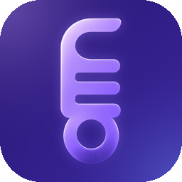
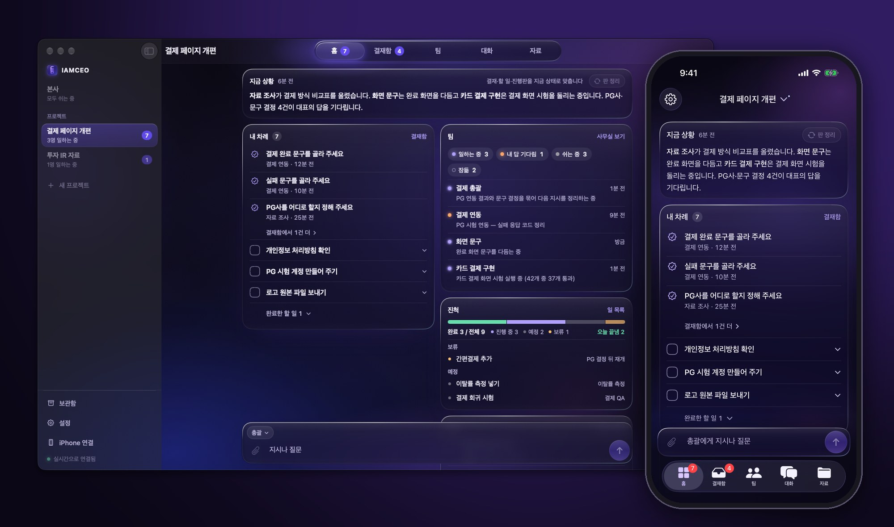
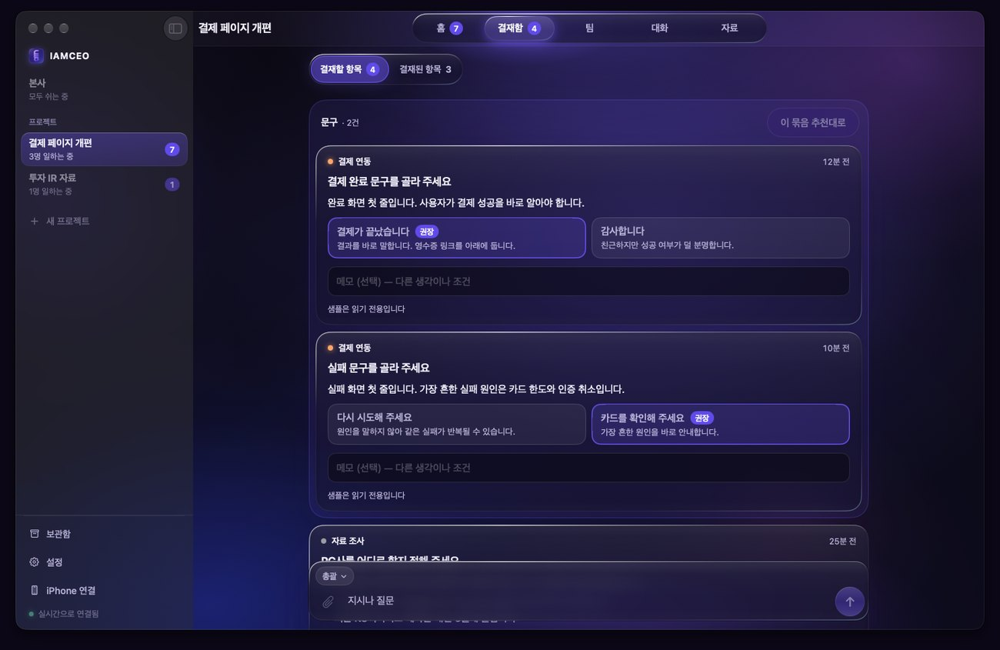
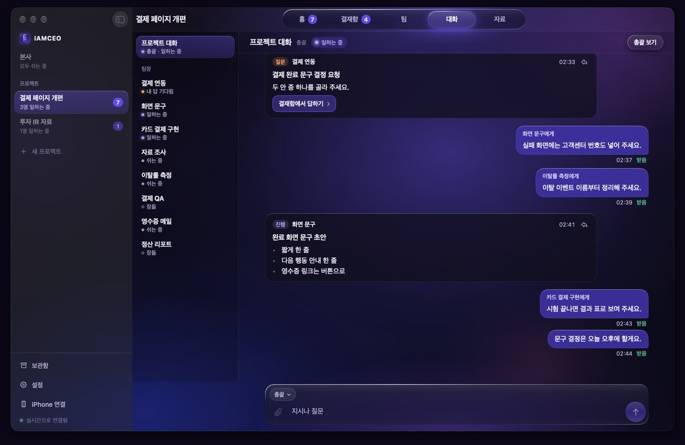
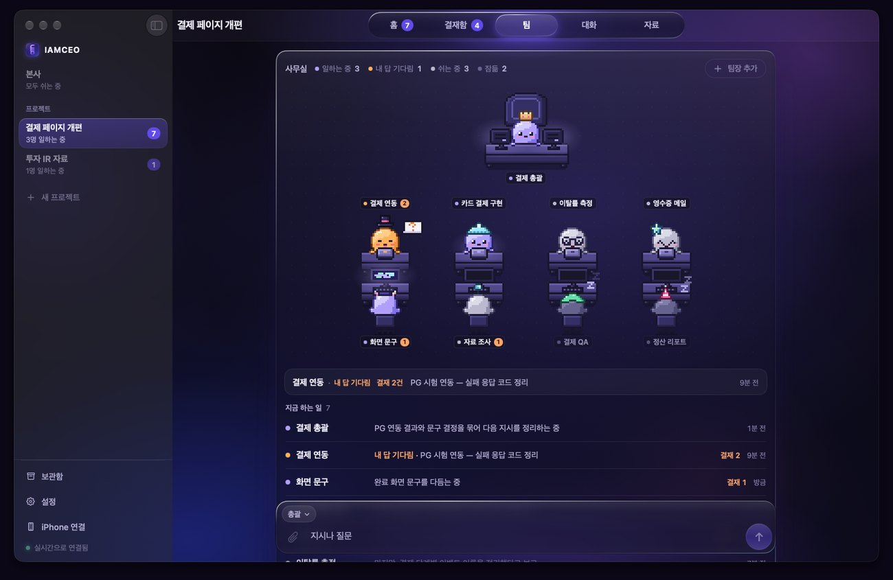
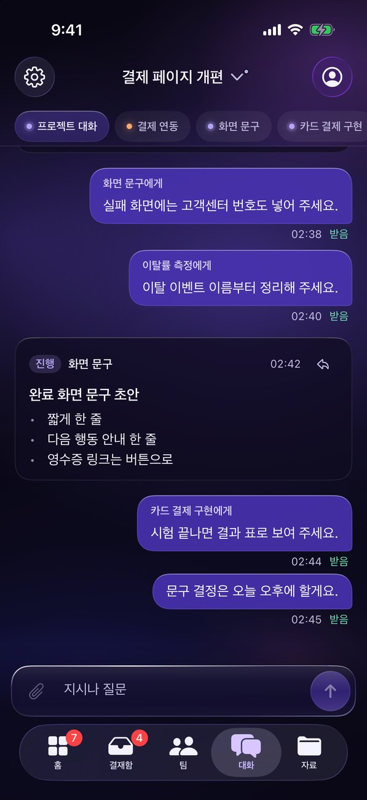
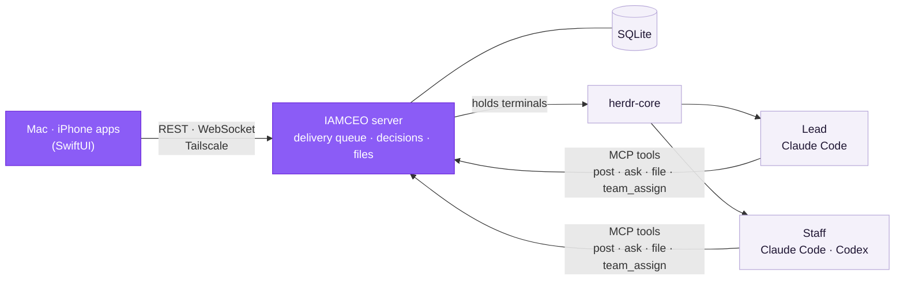

<div align="center">



# IAMCEO

**Run your AI coding agents like a company. You talk and decide — that's it.**

Split several Claude Code and Codex sessions into a lead and staff,<br/>
then give instructions and approve decisions from one Mac and iPhone app.

[](https://github.com/yehsung/IAMCEO/releases/latest)
[](#install)
[](LICENSE)

[Install](#install) · [Quick start](#quick-start) · [User guides](docs/guide/README.md) · [Terms](#terms) · [What is different](#what-is-different) · [How it works](#how-it-works) · [Security](docs/security.en.md) · [Changelog](CHANGELOG.md) · [한국어](README.ko.md)



</div>

> **Language:** the app's screens are in Korean today. The lead and staff can write their reports, decision cards and to-dos to you in English (설정 → 일반 → 보고 언어, Settings → General → Report language), and the installer and the command-line tool speak English. The [user guides](docs/guide/README.md) are in English and Korean.

- **Stop babysitting terminals** — who is working, who is done and who is stuck at a permission prompt, on one Home screen.
- **One Inbox for every decision** — staff questions and approvals arrive as cards with background, the outcome of each option and a recommendation.
- **One job per staff member** — the lead splits the work and hands it to the right staff, so contexts never mix.
- **Deliverables, not paths** — documents, tables, images, videos and HTML pages open right in the app, under Files.
- **Keep going away from the desk** — instruct and approve from your iPhone while your Mac keeps the work running. iPhone notifications have a condition → [Notifications](#notifications).
- **Your records, on your Mac** — conversations, decisions and files live in SQLite on your Mac and survive AI account changes.
- **Your CLI setup carries over** — agents run the official Claude Code and Codex CLIs under your own log-in, so what you keep in the CLIs' settings files — settings, MCP servers, skills, `CLAUDE.md` — keeps working. → [What is different](#what-is-different)
- **No reinvented wheels** — the official CLIs, herdr-core, MCP, SQLite and Tailscale are used as they are; IAMCEO builds only the layer that makes them work like a company. → [Design](#how-it-works)

Mac and iPhone native apps are the supported clients. The iOS app is for iPhone only; iPad is not supported. The web client was removed on 2026-11-10; existing native app API contracts remain supported.

## Install

```sh
brew install --cask yehsung/tap/iamceo
```

Or `curl -fsSL https://raw.githubusercontent.com/yehsung/IAMCEO/main/install.sh | sh` · [download the DMG](https://github.com/yehsung/IAMCEO/releases/latest)

**Requires** an Apple Silicon Mac on macOS 14+ and [Claude Code](https://claude.com/claude-code), installed and logged in. [Codex CLI](https://github.com/openai/codex) is optional. Each CLI runs under your own account and its usage limits.

**Know this before you start:** by default, the lead and staff run commands without stopping at approval prompts (Claude Code in `bypassPermissions` mode, Codex with approvals and its sandbox bypassed). The first time you start on a Mac you choose one of three — don't ask (the default choice), ask only when risky, or ask every time — and you can change it later in Settings. What the server enforces and what is only a promise is in [Who decides](#who-decides); the trust model is in [Security](docs/security.en.md).

## Quick start

1. Open IAMCEO and choose **이 Mac에서 시작** (Start on this Mac). The server registers as a login service and connects right away.
2. Create a **New project** from a folder (or a new folder, or a GitHub repository). Every project gets a lead.
3. Write what you want in **Conversation**. The lead picks the right staff member and hands the work over.
   > You: Rewrite the payment-failure screen copy so it includes the support number<br/>
   > Lead: Got it — assigned to Screen copy.
4. Decisions collect in the **Inbox**, deliverables in **Files**, and your own to-dos on **Home**.

**iPhone:** join your Mac and iPhone to [Tailscale](https://tailscale.com), then scan the **iPhone 연결** (Connect iPhone) QR in the Mac app. Get the iPhone app [on the App Store](https://apps.apple.com/app/id6831782194). If an iPhone that used to connect no longer does, check that Tailscale is on on the Mac; the Mac app tells you when it is off. → [Connecting an iPhone](docs/guide/iphone.en.md)

**When stuck:** 설정 → AI 모델 → 실행 환경 (Settings → AI models → Runtime) checks the engine, the Claude Code and Codex sign-ins, Tailscale, start at login and backups, item by item, with a fix for each. `iamceo doctor` does the same from the command line. → [Troubleshooting](docs/guide/troubleshooting.en.md)

### Notifications

- **Mac:** works. Turn on **Mac 알림** (Mac notifications) in the Mac app's Settings.
- **iPhone:** a push notification is sent only when your Mac's server holds the Apple push key (APNs) that belongs to the iPhone app. IAMCEO runs no server of its own, so nothing else can send it for you. The iPhone app from the App Store therefore **cannot receive notifications today**. They work only with an iPhone app you build yourself and your own key → [native guide](native/README.md#iphone-apns-and-signing).

### User guides

| Guide | What it covers |
|---|---|
| [Getting started](docs/guide/getting-started.en.md) | Checklist, install, first project, report language, the command-line tool |
| [Troubleshooting](docs/guide/troubleshooting.en.md) | The self-check, common problems, the diagnostic file, changing the role rules |
| [Connecting an iPhone](docs/guide/iphone.en.md) | Tailscale and MagicDNS, the pairing QR, when notifications work |
| [Upgrade, backup and uninstall](docs/guide/upgrade-backup-uninstall.en.md) | Updating and rolling back, backups and a new Mac, retention, exporting and deleting projects, stopping everything |
| [Security](docs/security.en.md) | What IAMCEO trusts, blocks and does not block |

## Terms

The English text here says *lead* and *staff*. The app's screens are Korean, so this is what you will see there.

| Here | In the app | What it is |
|---|---|---|
| Lead | 총괄 | One per project. Splits the work, hands it to staff and sums up their reports. It does not do the work itself. |
| Staff | 팀장 | A session that does the actual work. A project has several, one per kind of job. |
| Sub-agent | 직원 | Helpers that a staff session starts inside its own CLI for parts of its job. They report to that staff session, never to you. |
| HQ | 본사 | The entry that belongs to no project. See below. |
| Inbox | 결재함 | Where questions and approvals wait for your answer. |

**HQ (본사)** is created automatically and cannot be archived. Its single agent (본사 AI) creates new projects for you and handles one-off jobs that belong to no project.
It has no staff, and its working folder is your home folder.

## Screens

<table>
<tr>
<td width="50%"><br/><b>Inbox</b> — cards waiting for your decision, and past ones</td>
<td width="50%"><br/><b>Conversation</b> — instructions and reports, with delivery state</td>
</tr>
<tr>
<td width="50%"><br/><b>Team</b> — a desk per member: working, idle, waiting for approval, asleep</td>
<td width="50%" align="center"><br/><b>iPhone</b> — the same desk, away from your Mac</td>
</tr>
</table>

## What is different

Only what the code actually does.

- **Decisions do not get buried in the chat.** Every question and approval becomes a card in the Inbox. When the lead passes your words on to staff, the server compares the quote with what you really wrote and labels it as confirmed or unconfirmed.
- **Delivery is checked, not assumed.** After your message is typed into a CLI, the server looks for it in the session record that the CLI itself writes. When it cannot tell, it does not type the message a second time.
- **The record stays with you.** Conversations, decisions and files are kept in SQLite on your Mac, and you read and answer them in a native iPhone app.
- **Your CLI setup carries over.** IAMCEO starts the official `claude` and `codex` programs in your project folder, as your own user, with your normal configuration folders. It passes no option that switches your configuration off or swaps it out, and it never writes to the CLIs' settings files. So whatever the CLI loads from its settings files and folders is loaded here too:
  - your log-in and subscription
  - your user and project settings (`~/.claude/settings.json`, the project's `.claude/` folder, `~/.codex/config.toml`), hooks included
  - the MCP servers you have already set up — IAMCEO adds one of its own for the session and leaves yours in place
  - your skills, plugins and custom commands
  - `CLAUDE.md` and `AGENTS.md` — IAMCEO's role instructions are passed in next to them, not in their place

  One thing does not carry over: your terminal's shell environment. The server runs as a login item, so it does not get the environment variables and PATH that your shell start-up files (`~/.zshrc` and the like) set, and the CLIs run with the server's environment. Anything that depends on an environment variable (an MCP server that refers to `${GITHUB_TOKEN}`, a log-in through `ANTHROPIC_API_KEY`) or on a particular PATH (an MCP server or hook that calls `uvx` or `node` installed through pyenv, mise or cargo) can work in your terminal and fail here. Put such values in the `env` of the CLI's settings file, and write commands as absolute paths.

  What IAMCEO sets for its own sessions, each time it starts one:
  - the permission mode you chose in IAMCEO, and permission to call IAMCEO's own tools without a prompt
  - the model and effort, only if you picked them in IAMCEO; otherwise the CLI's own default
  - Claude Code: the status line is wrapped so IAMCEO can read context usage (your own status line command still runs), and prompt suggestions are off
  - Codex: multi-agent is on, the update check at start is off, and the role instructions go in as `developer_instructions`, which takes the place of one set in your `config.toml` for these sessions

**What it does not do**

- **No separate working folder per staff member.** Staff in a project share the project folder; there is no git worktree per session. The lead is instructed to send work that touches the same files to the same staff member, where it waits in a queue. Nothing locks files between staff.
- **No automatic merging.** IAMCEO does not create branches or merge them for you.
- **No sandbox of its own.** Agents run as your macOS user with the permission mode you chose → [Security](docs/security.en.md).

## How it works

**Use what is already good, build only what was missing.** IAMCEO does not ship its own AI model, terminal multiplexer or agent protocol. What it builds is the layer on top that makes several sessions work like a company. That keeps the program small, and when any of those parts improves, IAMCEO improves with it.



<sub>Purple is what IAMCEO builds; the light boxes are reused as they are.</sub>

### Reused

| Job | What does it | What you get |
|---|---|---|
| The AI and its coding tools | The official [Claude Code](https://claude.com/claude-code) and [Codex CLI](https://github.com/openai/codex) | Your own subscription and log-in. No API key, no fee added by IAMCEO, and new CLI features arrive as soon as the CLI ships them. |
| Holding terminals | [herdr-core](https://github.com/herdrdev/herdr-core) | Sessions stay alive when you close the app or restart the server. |
| Talking to the agents | The [MCP](https://modelcontextprotocol.io) standard | No screen scraping. Reports and requests arrive as tool calls, so everything is recorded. |
| Server and data | [Bun](https://bun.sh) and SQLite | No database server to install. Your data sits in one folder on your Mac (`~/.iamceo`: a SQLite database and the attachments), and the server makes a checked backup of it once a day. Only two runtime packages. |
| Terminal view | [SwiftTerm](https://github.com/migueldeicaza/SwiftTerm) | See a staff member's real terminal inside the app, and type into it. |
| Remote access | [Tailscale](https://tailscale.com) | No open ports and no relay. There is no server run by IAMCEO. |
| Notifications, secrets, always-on | macOS notifications, APNs, Keychain, launchd | The way macOS and iOS already do it. iPhone push needs your own key → [Notifications](#notifications). |

### Built here

- **The company structure** — each project has a lead that splits the work and hands it to staff. Every staff member has its own session, so contexts never mix.
- **The Inbox** — staff questions and approvals become cards with background, the outcome of each option and a recommendation.
- **The delivery queue** — checks the session record to confirm your words really reached the CLI. When that is uncertain, it never types the same message twice. If the network drops or a usage limit hits, it continues once that clears.
- **Owner-quote checking** — when the lead quotes you, the server compares the quote with your original words and marks the result.
- **Files** — documents, tables, images, videos and HTML pages made by staff open right in the app.
- **The Mac and iPhone apps** — one SwiftUI codebase, the same screens on both.

### Design rules

- **The official CLIs, unchanged.** Claude Code and Codex run in interactive terminals under your own log-ins. IAMCEO only adds role instructions and an MCP connection, and never edits the CLIs' global settings.
- **Sessions outlive the apps and the server.** herdr-core holds the terminals, so closing the app or restarting the server never stops the work.
- **No guessing at state.** Whether a member is working or done comes from the record the CLI writes. When that is unknown, IAMCEO stops typing and asks you to check.
- **Reports are tool calls, not screen scraping.** Reports (`post`), decisions (`ask`), files (`file`) and assignments (`team_assign`) are all recorded.
### Who decides

You do. But part of that is enforced by the server and part is a promise the agents are instructed to keep. The two are not the same.

| Rule | Held by |
|---|---|
| Each role can call only its own tools. Staff cannot hand out work, only the lead can; only HQ can create a project. | **Server** |
| Every message an agent receives starts with a source label written by the server (you, the lead, a report, the system). Text that imitates a label is turned into a quote. | **Server** |
| When the lead quotes you to staff, the server compares the quote with your original words and marks it confirmed or unconfirmed. | **Server** |
| Your answer to a decision goes straight to the staff member who asked. The lead cannot reword it on the way. | **Server** |
| A file an agent uploads must be inside its working folder. Secret folders, key files and IAMCEO's own data are refused. | **Server** |
| Committing, pushing, deleting, sending anything outside and spending money happen only after a sentence from you. | **Instructions** — a promise the agents follow, not a block |

The server marks what you said; stopping at that mark is up to the agent. An agent that ignores its instructions can still run `git push`, because it runs as your user. Choose "ask only when risky" or "ask every time" if you want the CLI itself to stop first.

Components are in [architecture](docs/architecture.md) and every rule in the [operating model](docs/operating-model.md) (both in Korean). The trust model is in [Security](docs/security.en.md), and the guides for using IAMCEO are in [docs/guide](docs/guide/README.md).

<details>
<summary><b>Build from source</b></summary>

Requires Xcode 26, [XcodeGen](https://github.com/yonaskolb/XcodeGen) and [Bun](https://bun.sh) 1.3+.

```sh
git clone https://github.com/yehsung/IAMCEO.git && cd IAMCEO
bun install
bun run build:native            # dist/native/IAMCEO.app
open -n dist/native/IAMCEO.app --args --demo   # read-only sample, no connection
```

Tests run isolated, with a temporary data home, automatic ports and fake CLIs:

```sh
bun run check   # typecheck · server tests · app tests · unsigned builds
```

To install on your own iPhone, set the bundle ID and team in `native/project.yml` to yours → [native guide](native/README.md)

The steps for signing, notarizing and publishing the apps are in the [release procedure](docs/releasing.md) (Korean).

</details>

## Thanks

IAMCEO stands on good tools. [herdr-core](https://github.com/herdrdev/herdr-core) (Apache-2.0) keeps the terminals alive, [SwiftTerm](https://github.com/migueldeicaza/SwiftTerm) (MIT) renders them, and the [MCP SDK](https://github.com/modelcontextprotocol/typescript-sdk) (MIT) connects the agents. Notices for every bundled open-source component are in [THIRD-PARTY-NOTICES.md](THIRD-PARTY-NOTICES.md).

## License

IAMCEO is **source-available** under the Sustainable Use License 1.0 plus IAMCEO Additional Permissions.

- Free to use personally and inside your company, modify, share free of charge, and use as a tool for client work.
- Selling IAMCEO or a modified version, offering it as paid hosting or SaaS, or embedding it in a commercial product needs separate permission.

See [LICENSE](LICENSE), the plain-language [LICENSING.ko.md](docs/LICENSING.ko.md) (Korean) and [CONTRIBUTING.md](CONTRIBUTING.md). To report a vulnerability, see [SECURITY.md](SECURITY.md). Versions published before November 7, 2026 (including v0.1.0) were released under AGPL-3.0-only, and recipients keep those rights.
