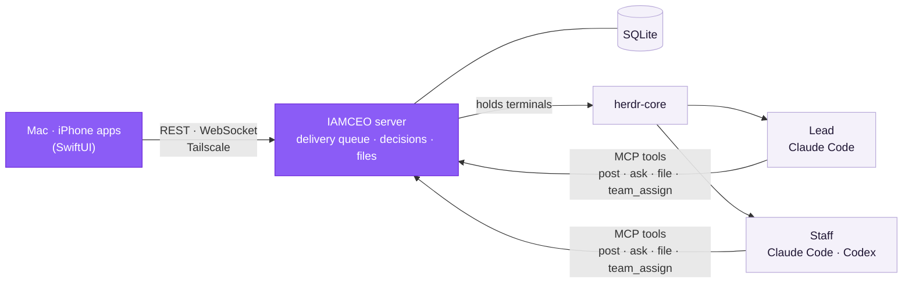

<div align="center">


# IAMCEO

**Run your AI coding agents like a company. You talk and decide — that's it.**

Split several Claude Code and Codex sessions into a lead and staff,<br/>
then give instructions and approve decisions from one Mac and iPhone app.

[](https://github.com/yehsung/IAMCEO/releases/latest)
[](#install)
[](LICENSE)

[Install](#install) · [Quick start](#quick-start) · [Screens](#screens) · [How it works](#how-it-works) · [Ground rules](docs/operating-model.md) · [한국어](README.ko.md)


</div>

- **Stop babysitting terminals** — who is working, who is done and who is stuck at a permission prompt, on one Home screen.
- **One Inbox for every decision** — staff questions and approvals arrive as cards with background, the outcome of each option and a recommendation.
- **One job per staff member** — the lead splits the work and hands it to the right staff, so contexts never mix.
- **Deliverables, not paths** — documents, tables, images, videos and HTML pages open right in the app, under Files.
- **Keep going away from the desk** — instruct, approve and get notified from your iPhone while your Mac keeps the work running.
- **Your records, on your Mac** — conversations, decisions and files live in SQLite on your Mac and survive AI account changes.
- **No reinvented wheels** — the official CLIs, herdr-core, MCP, SQLite and Tailscale are used as they are; IAMCEO builds only the layer that makes them work like a company. → [Design](#how-it-works)

Mac and iPhone native apps are the supported clients. The web client was removed on 2026-11-10; existing native app API contracts remain supported.

## Install

```sh
brew install --cask yehsung/tap/iamceo
```

Or `curl -fsSL https://raw.githubusercontent.com/yehsung/IAMCEO/main/install.sh | sh` · [download the DMG](https://github.com/yehsung/IAMCEO/releases/latest)

**Requires** an Apple Silicon Mac on macOS 14+ and [Claude Code](https://claude.com/claude-code), installed and logged in. [Codex CLI](https://github.com/openai/codex) is optional. Each CLI runs under your own account and its usage limits.

## Quick start

1. Open IAMCEO and choose **이 Mac에서 시작** (Start on this Mac). The server registers as a login service and connects right away.
2. Create a **New project** from a folder (or a new folder, or a GitHub repository). Every project gets a lead.
3. Write what you want in **Conversation**. The lead picks the right staff member and hands the work over.
   > You: Rewrite the payment-failure screen copy so it includes the support number<br/>
   > Lead: Got it — assigned to Screen copy.
4. Decisions collect in the **Inbox**, deliverables in **Files**, and your own to-dos on **Home**.

**iPhone:** join your Mac and iPhone to [Tailscale](https://tailscale.com), then scan the **iPhone 연결** (Connect iPhone) QR in the Mac app. For now the iPhone app is built from source → [guide](native/README.md)

## Screens

<table>
<tr>
<td width="50%"><br/><b>Inbox</b> — cards waiting for your decision, and past ones</td>
<td width="50%"><br/><b>Conversation</b> — instructions and reports, with delivery state</td>
</tr>
<tr>
<td width="50%"><br/><b>Team</b> — a desk per member: working, idle, waiting for approval, asleep</td>
<td width="50%" align="center"><br/><b>iPhone</b> — the same desk, away from your Mac</td>
</tr>
</table>

## How it works

**Use what is already good, build only what was missing.** IAMCEO does not ship its own AI model, terminal multiplexer or agent protocol. What it builds is the layer on top that makes several sessions work like a company. That keeps the program small, and when any of those parts improves, IAMCEO improves with it.



<sub>Purple is what IAMCEO builds; the light boxes are reused as they are.</sub>

### Reused

| Job | What does it | What you get |
|---|---|---|
| The AI and its coding tools | The official [Claude Code](https://claude.com/claude-code) and [Codex CLI](https://github.com/openai/codex) | Your own subscription and log-in. No API key, no fee added by IAMCEO, and new CLI features arrive as soon as the CLI ships them. |
| Holding terminals | [herdr-core](https://github.com/herdrdev/herdr-core) | Sessions stay alive when you close the app or restart the server. |
| Talking to the agents | The [MCP](https://modelcontextprotocol.io) standard | No screen scraping. Reports and requests arrive as tool calls, so everything is recorded. |
| Server and data | [Bun](https://bun.sh) and SQLite | No database server to install. Your data is one file, so a backup is one copy. Only two runtime packages. |
| Terminal view | [SwiftTerm](https://github.com/migueldeicaza/SwiftTerm) | See a staff member's real terminal inside the app, and type into it. |
| Remote access | [Tailscale](https://tailscale.com) | No open ports and no relay. There is no server run by IAMCEO. |
| Notifications, secrets, always-on | APNs, Keychain, launchd | The way macOS and iOS already do it. |

### Built here

- **The company structure** — each project has a lead that splits the work and hands it to staff. Every staff member has its own session, so contexts never mix.
- **The Inbox** — staff questions and approvals become cards with background, the outcome of each option and a recommendation.
- **The delivery queue** — checks the session record to confirm your words really reached the CLI. When that is uncertain, it never types the same message twice. If the network drops or a usage limit hits, it continues once that clears.
- **Owner-quote checking** — when the lead quotes you, the server compares the quote with your original words and marks the result.
- **Files** — documents, tables, images, videos and HTML pages made by staff open right in the app.
- **The Mac and iPhone apps** — one SwiftUI codebase, the same screens on both.

### Design rules

- **The official CLIs, unchanged.** Claude Code and Codex run in interactive terminals under your own log-ins. IAMCEO only adds role instructions and an MCP connection, and never edits the CLIs' global settings.
- **Sessions outlive the apps and the server.** herdr-core holds the terminals, so closing the app or restarting the server never stops the work.
- **No guessing at state.** Whether a member is working or done comes from the record the CLI writes. When that is unknown, IAMCEO stops typing and asks you to check.
- **Reports are tool calls, not screen scraping.** Reports (`post`), decisions (`ask`), files (`file`) and assignments (`team_assign`) are all recorded.
- **Only you decide.** Sending anything outside, committing or pushing, deleting and spending money need a sentence from you.

Components are in [architecture](docs/architecture.md) and every rule in the [operating model](docs/operating-model.md) (both in Korean).

<details>
<summary><b>Build from source</b></summary>

Requires Xcode 26, [XcodeGen](https://github.com/yonaskolb/XcodeGen) and [Bun](https://bun.sh) 1.3+.

```sh
git clone https://github.com/yehsung/IAMCEO.git && cd IAMCEO
bun install
bun run build:native            # dist/native/IAMCEO.app
open -n dist/native/IAMCEO.app --args --demo   # read-only sample, no connection
```

Tests run isolated, with a temporary data home, automatic ports and fake CLIs:

```sh
bun run check   # typecheck · server tests · app tests · unsigned builds
```

To install on your own iPhone, set the bundle ID and team in `native/project.yml` to yours → [native guide](native/README.md)

</details>

## Thanks

IAMCEO stands on good tools. [herdr-core](https://github.com/herdrdev/herdr-core) (Apache-2.0) keeps the terminals alive, [SwiftTerm](https://github.com/migueldeicaza/SwiftTerm) (MIT) renders them, and the [MCP SDK](https://github.com/modelcontextprotocol/typescript-sdk) (MIT) connects the agents. Notices for every bundled open-source component are in [THIRD-PARTY-NOTICES.md](THIRD-PARTY-NOTICES.md).

## License

IAMCEO is **source-available** under the Sustainable Use License 1.0 plus IAMCEO Additional Permissions.

- Free to use personally and inside your company, modify, share free of charge, and use as a tool for client work.
- Selling IAMCEO or a modified version, offering it as paid hosting or SaaS, or embedding it in a commercial product needs separate permission.

See [LICENSE](LICENSE), the plain-language [LICENSING.ko.md](docs/LICENSING.ko.md) (Korean) and [CONTRIBUTING.md](CONTRIBUTING.md). Versions published before November 7, 2026 (including v0.1.0) were released under AGPL-3.0-only, and recipients keep those rights.
