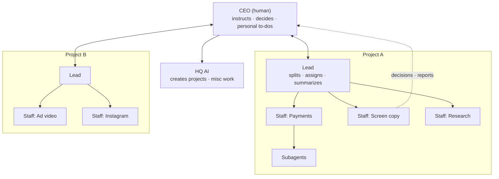
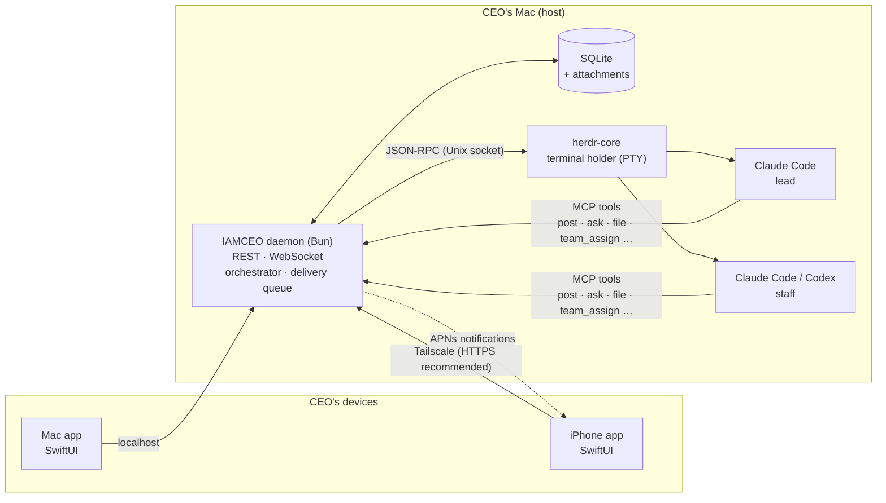
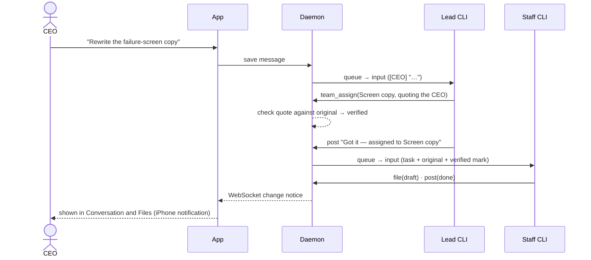

# IAMCEO

[한국어](README.ko.md)

**You are the CEO; the AI sessions are your staff.** IAMCEO is a Mac and iPhone desk for running several Claude Code and Codex sessions as one company. The CEO only talks and decides. A lead splits the work, staff do it, and the server owns delivery and records.

You never have to watch terminals. Five screens — Home, Inbox, Team, Conversation and Files — are where you give instructions, make decisions and receive results.

## Why it exists

Running several AI coding agents alone keeps hitting the same problems:

- **You have to babysit them.** To know which session is working, done, or stuck at a permission prompt, you open terminal after terminal.
- **Questions and approvals get lost.** Each session asks in its own window, and work stalls until you notice.
- **Context gets mixed.** Feeding unrelated tasks into one session lets the last task's context blur the next one.
- **Results never reach you.** You get "saved to ~/project/out/report.md", a path you cannot open from your phone.
- **Leaving the desk stops everything.** Away from the Mac you can neither instruct, approve, nor check progress.

IAMCEO solves this with a **company structure**. One person (the CEO) and many AI sessions split into roles, and each role has things it must and must not do. The server enforces some rules; role instructions given to every session carry the rest.

## The company



| Role | Count | Does | Does not |
|---|---|---|---|
| **CEO** (human) | 1 | Instructs, decides, does what only a person can (log-ins, payments) | |
| **HQ AI** | 1 overall | Creates projects, handles work outside any project | Take over an existing project's work |
| **Lead** | 1 per project | Splits work, assigns the right staff, summarizes reports, keeps the boards current | Edit code or research itself, answer for the CEO |
| **Staff** | many per project | The actual work (code, documents, research, release prep) | Anything hard to undo without the CEO's approval |
| **Subagents** | under staff | Pieces of a staff task, in parallel | Report to the CEO directly |

Each staff member exists for **one job**. Staff are named after that job (`Payments`, `Screen copy`), never after people. Leads and staff can each run Claude Code or Codex.

## Ground rules

1. **Only the CEO decides.** No AI answers on the CEO's behalf, and a lead's "go ahead" is not approval. Submitting or sending anything outside, starting work, committing or pushing, deleting, and spending money happen only when the CEO wrote a sentence asking for it.
   - *Server-checked:* when a lead quotes the CEO in an instruction, the server compares the quote with the CEO's original message or decision answer and marks it server-verified, needs-context (button labels and very short text) or unverified. Staff decide from that mark and the original whether they have approval; stopping is their role rule.
   - *Delivered by the server:* decision answers go straight from the server to the staff member who asked, word for word, so a lead cannot change them on the way.
2. **The lead does not do the work.** It splits, assigns and summarizes. Staff do the work.
3. **One job per staff member.** Staff are split so contexts never mix.
   - If the right staff member is asleep, the lead wakes it and its history continues; it does not hire a new one.
   - It hires only when no one fits.
   - A busy staff member is never interrupted; new work waits in its queue.
4. **The CEO never watches terminals.**
   - On every instruction the lead answers right away, for example "Got it — assigned to Screen copy."
   - Finished or blocked work is reported in the conversation.
   - Deliverables (documents, tables, images, videos) go to Files, not just a path in chat.
   - *Server backstop:* if a turn started by the CEO ends with work assigned but no `post` at all, the server adds "Lead assigned it to …" to the conversation.
5. **Everything to decide goes to one Inbox.** Questions, choices and approvals all become Inbox cards.
   - Each card carries the background, the outcome of each option and a recommendation, so you can decide from the card alone.
   - Things only the CEO can do are kept separately as your to-dos.
6. **The server owns delivery.** It queues work, wakes sleeping staff, sends the next task when one finishes, and labels every input with its source. If it is unsure whether a message arrived, it **does not resend automatically**: stopping to check beats delivering the same instruction twice. The CEO can resend after accepting the duplicate risk.
7. **The records belong to the CEO.** Conversation, decision, work and file records live in SQLite on the CEO's Mac, with attachment files stored next to it. They survive AI account changes and are backed up together on a schedule.

## How you use it

**1. Create a project.** Pick a folder, make a new one, or import a GitHub repository. Every project gets a lead.

**2. Tell the lead what you want, in Conversation.**

> CEO: Rewrite the payment-failure screen copy so it includes the support number
>
> Lead: Got it — assigned to Screen copy.

You can also talk to a staff member directly by picking them in Conversation.

**3. Staff work and report.** Progress, completion and blockers appear in the conversation, and deliverables collect in Files. Tap a file path in chat to preview it in the app and publish it to Files.

**4. Decide.** When your judgement is needed, a card appears in the Inbox, and your iPhone gets a notification if you turned them on. Pick an option and confirm; the answer goes straight to the staff member who asked. Staff stuck at a Claude or Codex folder-trust prompt are approved from the Inbox too. Other CLI permission prompts, or prompts IAMCEO does not recognize, are handled in the terminal.

**5. Look only when you need to.**

| Screen | What you see |
|---|---|
| **Home** | A one-paragraph status, your turn (decisions, approvals, blocked deliveries), team, progress and recent news |
| **Inbox** | Cards waiting for your decision, and past decisions |
| **Team** | The office view: a desk per member showing working, idle, waiting for approval or asleep. Also member details, the progress board and terminals |
| **Conversation** | Messages and reports with the lead and staff, with delivery state (queued · received) |
| **Files** | Documents, tables, code, images, videos and HTML pages (artifacts) |

Open a terminal only when you must. While you control it directly, automatic delivery pauses so inputs never interleave. Control is released 5 minutes after your last input.

## Architecture



- **The daemon and SQLite are the source of truth.** The apps read state and send requests; they make no decisions of their own. Mac and iPhone see the same state.
- **AI runs through the official CLIs, unchanged.** Claude Code and Codex run in interactive terminals under your own account log-ins. IAMCEO adds only role instructions and an MCP connection per run; it does not reimplement any model API.
- **Sessions outlive the apps and the server.** herdr-core holds the terminals. Closing an app or restarting the server leaves the CLIs working, and a restarted server reattaches to the same terminals.
- **Reports are tool calls, not screen scraping.** Sessions record their work with MCP tools: `post` (report), `ask` (decision), `todo` (CEO to-do), `file` (Files) and `team_assign` (assign).
- **State is observed, not guessed.** Working, idle and waiting-for-approval come from the CLI's status marks (OSC 7501) and turn numbers. When the state is unknown, automatic input stops.

How one instruction flows:



See [architecture](docs/architecture.md) for components and the [operating model](docs/operating-model.md) for every rule (both in Korean).

## Getting started

### Mac

Requires macOS 14+, Xcode with Swift 6, XcodeGen, Bun 1.3+, and the official CLIs you want to use (Claude Code, Codex), installed and logged in. Liquid Glass controls need macOS/iOS 26; earlier systems use materials.

```sh
bun install
bun run build:native
open dist/native/IAMCEO.app
```

Put the app at a stable path (for example `/Applications`) and choose **이 Mac에서 시작** (Start on this Mac).
- The app registers its bundled daemon as a launchd service. Building alone never installs or starts a service.
- A healthy existing IAMCEO is reused; a conflicting installation is never overwritten.
- herdr-core ships inside the app, pinned and checksum- and signature-verified, so you don't install it separately.
- Data lives in `~/.iamceo`.

```sh
# Read-only sample, no connection
open -n dist/native/IAMCEO.app --args --demo

# Run the server from source, without the app
bun run setup:core
bun run start
bun bin/iamceo.ts open   # another terminal: address and access code
```

### iPhone

1. Generate the project with `xcodegen generate --spec native/project.yml` and install the `IAMCEO-iOS` scheme. Physical devices need an Apple development team for signing. See the [native guide](native/README.md).
2. Join the Mac and iPhone to Tailscale. The recommended connection exposes the Mac's `http://127.0.0.1:7878` with **Tailscale Serve HTTPS** and enters that HTTPS address and the access code in the iPhone app. `bun bin/iamceo.ts open` shows the code.
3. For a quicker setup, open **iPhone 연결** (Connect iPhone) in the Mac app and scan the QR with the iPhone. The QR carries the daemon's Tailscale address (HTTP, MagicDNS name). The code is kept in the device Keychain.

Work continues on the Mac when the apps are closed, as long as the Mac stays awake; sleep, power-off and reboots are not covered. With an APNs key configured on the host and notifications turned on in the iPhone app (and allowed by iOS), the iPhone is notified of new decisions, approval waits, errors and completion reports. While the app is open it just refreshes, without a banner.

## Current scope

- The default permission mode is `bypassPermissions` and can be changed in Settings. Each CLI runs with the host user's permissions under its provider's usage limits.
- Switching a member between Claude and Codex means **a new session plus a handoff**. Work, conversation and decision records stay; the model's internal context does not move.
- HTML pages in Files are shown as previews with scripts and external requests disabled.
- The web client (`web/`) is legacy, kept temporarily and **scheduled for removal**. Until then it uses the same server API and receives compatibility maintenance only, with no new features.
- Windows, Android, notarized builds and Intel Mac hardware testing are not yet in scope.

## Development

```sh
bash .pumasi/gates.sh ts      # typecheck
bash .pumasi/regress.sh       # server regression (temporary home, fake CLIs)
bash .pumasi/gates.sh swift   # app build and tests
bash .pumasi/gates.sh xcode   # unsigned macOS + iOS Simulator builds
```

Tests use a temporary data home, auto-assigned ports and fake CLIs. Never test against the real data home, port 7878 or a running service. Isolation rules are in the [operating model](docs/operating-model.md#격리-시험-실행).

[Architecture](docs/architecture.md) · [Operating model](docs/operating-model.md) · [Implementation contract](docs/spec.md) · [Native build and connection](native/README.md) · [herdr-core provenance](vendor/herdr-core/README.md)

## License

IAMCEO is **source-available**, not open source. The [IAMCEO License](LICENSE) is the Sustainable Use License 1.0 plus IAMCEO Additional Permissions.

- **Allowed:** read, learn from, use, modify and share it free of charge for non-commercial purposes, and use it inside your company.
- **Also allowed as a tool:** use it to serve clients, sell what you produce with it, and charge for installation or support.
- **Needs separate permission:** selling IAMCEO or a modified version, offering it as paid hosting or SaaS, or embedding it in a commercial product.

A plain-language explanation is in [docs/LICENSING.ko.md](docs/LICENSING.ko.md) (Korean); contribution notes are in [CONTRIBUTING.md](CONTRIBUTING.md).

Versions published before November 7, 2026 (including v0.1.0) were released under AGPL-3.0-only, and recipients keep those rights. Bundled third-party components keep their own licenses. herdr-core is Apache-2.0, and its license, notices and official signature are preserved. See [THIRD-PARTY-NOTICES.md](THIRD-PARTY-NOTICES.md).
